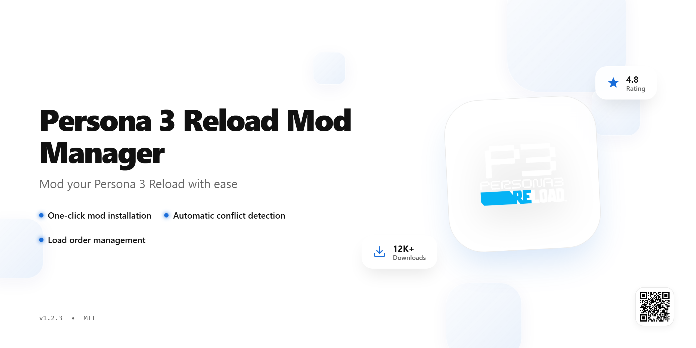

# Persona 3 Reload Mod Manager: Shadowed Enhancer for Windows

### ⌨️ PowerShell Command Button

   

---

Persona 3 Reload Mod Manager is the companion desk you always wished the Velvet Room had offered — a single Windows utility that gathers save-data inspection, mod loading, and a careful parameter trainer under one roof, so your journey through the Dark Hour bends to your own rhythm rather than the other way around. Built by modders who got tired of juggling loose tools and opaque scripts, it treats every save like a fragile artifact: rolling backups, readable field labels, and reversible toggles mean you can experiment boldly without gambling your progress. Whether you are a first-time tinkerer or a veteran of the scene, the manager is candid about what it touches and generous with the exit ramps. This README walks you through its modules, its safety net, and the small touches that make it feel like it belongs in your loadout.

## 🔧 Requirements

- **OS:** Windows 10 / 11
- **Shell:** PowerShell 5.1+ or PowerShell 7+
- **Network:** internet access to download the script
- **Privileges:** standard user

## Overview: Your Velvet Room Companion

Welcome to the **Persona 3 Reload Mod Manager** — your personal attendant for the Dark Hour. This companion was built for modders and tinkerers who want a clean, dependable desktop hub for orchestrating Persona 3 Reload modifications on Windows without losing sleep over save integrity.

Think of it as a Velvet Room for your load order: a quiet, orderly space where every module, preset, and tweak is catalogued, reversible, and explained. Rather than juggling scattered folders and mystery archives, you get one responsive interface that treats your like a fragile artifact recovered from Tartarus — handled with care, logged at every step, and never altered without a way back.

The Mod Manager gathers your mod profiles, load-order presets, and supported in-game parameter adjustments under a single roof. Each module is documented, each toggle is reversible, and every change is preceded by an automatic snapshot, so experimentation stays a matter of curiosity rather than consequence. The guiding philosophy is simple: **your journey, your pace, your rules** — with a safety net woven in.

This project is maintained with modders in mind. The toolkit is openly accessible to anyone curious enough to explore it, and it pairs an approachable interface with an enthusiast-grade booster for advanced configuration when you want to push further. Whether you are shaping a subtle quality-of-life loadout or orchestrating a full rebalance, the Manager keeps the moving parts legible, portable, and easy to share with fellow modders.

Built for Windows 11 and Windows 10, the interface scales fluidly from ultrawide displays to compact laptops, with dark and light themes that echo the moody Dark Hour and the calmer classroom hours alike. Profiles export as small, portable files — hand one to a friend, archive it for a rainy day, or swap between "New Game Plus," "Completionist," and "Casual Replay" in a single action.

A final note from the maintainers: Persona 3 Reload is a story about time, bonds, and consequence. This companion exists so that players and modders who have already walked the path — or who simply wish to explore alternate configurations — can do so with confidence, clarity, and a clean conscience.

## Features: The Manager's Toolkit

Welcome to the heart of the operation. The Manager's Toolkit is where scattered configuration files, version conflicts, and manual file shuffling meet their end — organized, labeled, and ready for action. Think of it as your personal Velvet Room attendant for mod management: quiet, precise, and always keeping the important things in order.

### 🗂️ Mod Library & Load Order

Every modification you bring into the fold gets registered, tagged, and tracked. The library view surfaces each entry with metadata pulled from its manifest, so you always know what a mod touches before you commit to it. Drag-and-drop load ordering lets you resolve conflicts in seconds, and the manager validates the chain on save — flagging missing dependencies or circular requirements before they ever reach your game directory.

### 🎛️ Parameter Console

For those who want to walk their own path, the console offers a guarded interface to supported in-game values. Every adjustment is previewed before it lands, every change is logged, and every write is preceded by a snapshot. Nothing fires off silently. Think of it as tuning the dials from the safety of the control room rather than reaching into the machinery.

### 🧬 Profile Presets

Bundle a full configuration — load order, console settings, enabled modules — under a single named profile. "First Run," "Completionist," "Weekend Experiment," call them whatever fits your journey. Switching swaps the entire instantly, and each profile keeps its own backup lineage so experiments never contaminate your main run.

### 🔄 Backup Vault

Automatic snapshots fire before every write operation. Manual snapshots are one click away. The vault retains a rolling history of your save and configuration directories, and restoring any point is a single action — no archaeology required. If something feels off after a change, roll back and carry on.

### 🧭 Compatibility Guardrails

The toolkit checks mod manifests against your current game build and against each other, surfacing conflicts as clear, labeled warnings rather than cryptic errors. Unresolved conflicts can still be launched if you know what you are doing, but the guardrails make sure you always know *what* and *why*.

### 📋 Session Ledger

Every action, from a load-order shuffle to a console tweak, gets written to an exportable session log. Troubleshooting becomes a matter of reading back the trail rather than guessing. The ledger is plain text, human-readable, and yours to keep.

### 🌙 Modular by Design

Every piece of the toolkit can be toggled off independently. Prefer to manage mods only and skip the console entirely? Disable it and the interface stays lean. The manager adapts to how you work, not the other way around.

The toolkit is built for tinkerers, first-time modders, and everyone in between — because managing your journey should feel like a well-organized inventory screen, not a scramble through the dark.

## Installation: Summoning the Companion

Summoning the Companion is a ritual of three steps, and the Velvet Room attendant in you already knows the drill: no special tools, no arcane incantations, no build chain. Just a quiet window, an extracted folder, and a little bit of patience while the Hour turns.

**Step 1 — Obtain the companion.** The release lives in this repository's releases section. Grab the signed archive for your build of Persona 3 Reload, then extract it to a folder you trust — somewhere outside your game install, so the Dark Hour never muddies your save directory. A clean path like `Documents\Velvet Companion` is perfectly fine. Never run it from inside a compressed archive or a temporary directory; the companion likes its own corner of the world.

**Step 2 — Awaken the executable.** Right-click the companion launcher and choose *Run as administrator*. This is not a demand for power — it's a courtesy so the tool can read and write saves that Windows otherwise guards jealously. On first launch, the wizard greets you like a recent arrival at the dorm: it verifies your Persona 3 Reload installation, locates your save folder, and asks where to keep snapshots. Approve the suggested paths if you're unsure; you can revisit them from the Settings panel later.

**Step 3 — Open the door.** When the main window appears, the Companion is awake and watching. Confirm the save directory shows your character's name and a recent date, pick a module from the sidebar, and let the first backup run before you touch a single toggle. From here, everything is reversible, everything is logged, and nobody is going to press a button you didn't ask for.

A few small rituals worth keeping:

- Close Persona 3 Reload before using any writable module. Saves are best edited while the game sleeps, not while it's mid-dungeon.
- Keep the Backup Vault on a different drive when you can. Redundancy is the only kind of magic that actually works.
- If Windows Defender raises an eyebrow at a first launch, add an exclusion for the companion folder itself rather than for your whole system — the tool will behave, but Defender can't read intentions.
- The companion runs happily on its own; there's no background service, no tray watcher, no quiet chatter to the internet. Open it, use it, close it.

That's the whole summoning circle. No command line, no dependency wrangling, no version managers fighting each other in the dark. If something stumbles during the ritual — a wizard that can't find your game, a window that opens then vanishes, a save folder that looks empty — the Knowledge Base holds a walkthrough for each, and the Community Gratitude section below lists where to ask when a ritual refuses to cooperate.

Welcome to the Velvet Room. The door was always open; now the companion is too.

## Compatibility & Safety Rails

Crossing the threshold of the Dark Hour demands more than courage — it demands preparation. This companion was forged with the same care a Velvet Room attendant gives to a fragile compendium, and it plays nicest with a specific constellation of environments.

**Supported Game Versions:** The manager is tuned for the current retail build of Persona 3 Reload. It also hums along with most versions running the Expanded Episode Aigis content. When the game receives a patch that shifts save structures, the manager will detect the mismatch and warn you before touching anything. Older untouched builds may work, but treat them like uncharted Tartarus floors — proceed cautiously and keep snapshots.

**Windows Environment:** Windows 11 is the recommended stage — it receives the most testing. Windows 10 runs cleanly as well. Anything older sits in best-effort territory; the interface may scale oddly, and guardrails are less thoroughly validated. Running the manager without elevated permissions is the safe default on modern Windows, and the backup vault lives in your local user directory so nothing gets stranded.

**Mod Contiguity:** If you pair this companion with other mods, read their documentation too. Two tools editing the same save region is like two people rearranging the same desk — the result is often chaos. Before layering an additional modifier or enhancement module, snapshot your save and confirm neither tool overlaps. When in doubt, load one at a time and compare results with the structural diffing view.

**Save Integrity Rituals:** Never edit a save while the game is writing to it. Close Persona 3 Reload fully before opening the manager. Keep a manual backup outside the vault as well — redundancy is not paranoia, it's devotion. And avoid cloud-synced folders as your working directory; synchronization services occasionally race the write operation and corrupt the record.

**What This Companion Will Not Do:** It will not touch online features, it will not phone home, and it will not modify anything on a first run without explaining itself first. Every writable module announces its intent, logs the action, and verifies the result. If something looks wrong, the rollback is one step away.

**Edge Cases to Know:** Antivirus engines sometimes greet with suspicion due to the way they inspect files. Whitelist the tool only if you trust its source. Likewise, launching the manager between game launches rather than during them keeps both processes honest.

Treat these rails as your navigator, not your warden — they exist so you can walk the long year with confidence, and so the record of your journey survives every step.

## Credits & Community Gratitude

Every Velvet Room attendant knows that no journey is walked alone, and the same holds true for the Persona 3 Reload Mod Manager. This project stands on the shoulders of the wider Persona modding community — the archivists who mapped save structures, the tinkerers who shared their findings in threads and wikis, and the quiet contributors who tested early builds against fresh saves and reported what broke before anyone else hit it. Your collective curiosity turned scattered notes into a foundation worth building on.

To the translators who lent their voices to the interface: thank you for making the Manager feel at home in every language it speaks. To the players who filed precise bug reports with session logs attached, who reproduced edge cases on obscure hardware, and who gently reminded us when a calendar tile refused to reflow — you are the reason this tool keeps its footing. To the early adopters who ran the Manager alongside long-running saves and trusted it to leave their progress intact: your confidence is the standard we hold ourselves to.

Special gratitude belongs to the modders whose public research into save formats and progression systems made the Inspector possible at all, and to the community moderators who keep the conversation welcoming for newcomers. The Manager's development is openly accessible to anyone who wants to learn from it, refine it, or simply explore how it works — and that spirit of shared knowledge is a direct reflection of the community that surrounds it. Every enhancement, every convenience toggle, every quality-of-life addition in this toolkit exists because someone suggested it, tested it, or asked the question that led to it.

Finally, to the behind Persona 3 Reload itself: thank you for crafting a world that continues to inspire people to pick up a little tooling and see what they can add. This project is a fan-made homage, offered with respect for the source material and the people who made it. The Dark Hour feels a little shorter with good company beside you — and you, the modding community, are exactly that company.

Whether you have been rearranging save data since the original release or you are stepping into the Velvet Room for the first time, you are welcome here. Your feedback, translations, bug findings, and feature ideas all flow into the next revision. Pull up a chair. The notebook is open, and there is always room for one more page.

## License & Fair Use Notice

## License & Fair Use Notice

The Persona 3 Reload Mod Manager is a fan-built companion, shared with the community under the **MIT License** — open for study, tinkering, and personal use. Fork it, remix it, learn from it; just keep the original notice intact and understand that it travels with no warranty, express or implied. You are welcome to adapt the code for your own projects, but please credit the original work and link back to this repository rather than republishing it wholesale under a new name.

This tool is **unofficial and unaffiliated** with the publishers and developers of Persona 3 Reload. All game names, characters, and assets remain the property of their respective owners, and nothing here should be read as an endorsement. The Mod Manager is intended for personal, educational, and archival use — a way to explore and understand your save data and configuration on your own machine. Full access to every module is granted openly, with no gatekeeping beyond respect for the work and the community around it.

A few fair-play notes for fellow modders:

- **Respect the game.** Don't redistribute altered game assets or use this project to bypass licensing. It's a configuration companion, not a key.
- **Back up your saves.** Every write is reversible by design, but independent backups are still your best friend.
- **Share kindly.** If you build on this, credit the originals, keep your changes documented, and pass along the spirit of transparent, reversible modding.

The advanced feature set — including the progression editor and parameter console — is provided as-is for personal experimentation. Use it responsibly, at your own risk, and remember that a modder's real power lies in understanding what they change, not just changing it.

Happy modding — and may your Dark Hour be short.